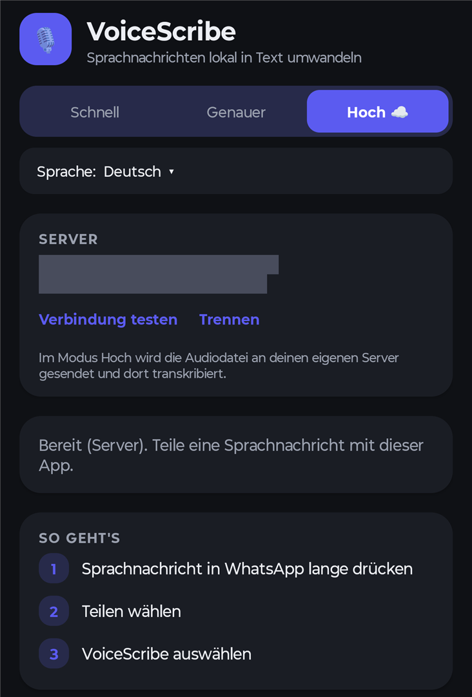
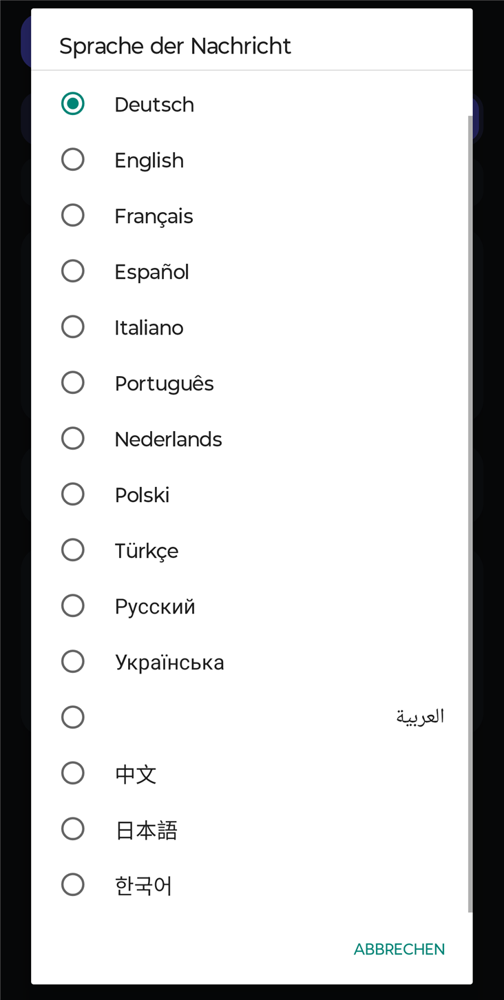

# VoiceScribe

Turn voice messages (WhatsApp and any other app that can share audio) into text. Share the message to
VoiceScribe, wait a few seconds, copy or share the text. Everything can run on the phone itself; for the best
accuracy you can point the app at your own GPU server.

The app's interface is in German. Messages can be transcribed in 16 languages or with automatic detection.

  
  &nbsp;&nbsp;
  

## Download and install

1. Open **[Releases -> Latest build](../../releases/tag/latest)** and download `VoiceScribe.apk`
   (rebuilt by GitHub Actions on every push to `main`; tags like `v1.0` create a numbered release).
2. Open the file on the phone and allow "install unknown apps" for your browser/file manager when asked.
3. Requirements: Android 8.0 or newer, a 64-bit ARM phone (practically every phone since ~2017).

The APK is **debug-signed** and every CI build uses a new debug key. Android refuses to update an app signed with
a different key, so uninstall the old build before installing a new one (this deletes the app's data: downloaded
models, history and the server pairing). Building it yourself and always installing your own build avoids that.

## Use it

1. Long-press a voice message in WhatsApp, tap **Share** ("Teilen"), choose **VoiceScribe**.
2. Pick a mode and a language at the top of the app (below). On the first use of a local mode the app downloads
   its model once; a progress bar shows it.
3. The text appears when it is done. Tap it to expand, then **Kopieren** (copy) or **Teilen** (share).
4. The last 10 transcriptions are kept in the history list (delete one with the X, or "Alle löschen").

| Mode | Where it runs | Download | Notes |
|---|---|---|---|
| **Schnell** | on the phone, Whisper *small* (int8) | about 375 MB, once | works offline afterwards; fastest, least accurate |
| **Genauer** | on the phone, Whisper *medium* (int8) | about 950 MB, once | clearly better, a few times slower |
| **Hoch ☁** | your own server, Whisper *large-v3* on a GPU | none | best accuracy, needs the server (below) |

**Language:** the "Sprache" row sets the language of the message (German by default, "Automatisch erkennen"
lets Whisper decide). Accuracy outside German and English is noticeably lower with the small on-device model;
use Genauer or Hoch for those. Automatic detection can guess wrong on very short or noisy clips.

## Privacy

- **Schnell / Genauer:** the audio never leaves the phone. The only network use is the one-time model download
  from Hugging Face (`csukuangfj/sherpa-onnx-whisper-*`) and GitHub (Silero VAD).
- **Hoch:** the audio is sent to the server you paired with, and only to it. Requests are signed with a per-device
  secret, so strangers cannot use your server. The audio is only as private as the connection to your server
  (see the server README: use HTTPS, and an encrypted tunnel if the server sits behind another one).
  The server logs timing and device name, never the transcript.
- The app uses its Internet permission only for the model download and, in Hoch mode, to reach your server.
  There is no analytics, account or third-party service. The pairing secret is stored encrypted with the
  Android Keystore, and Android cloud backup is switched off for the app.

## The server (Hoch mode)

`server/` is a small FastAPI service around [faster-whisper](https://github.com/SYSTRAN/faster-whisper) that runs on
Windows or Linux, ideally with an NVIDIA GPU (90 seconds of audio in about 21 s on an RTX 2080 Ti). It is optional;
the two on-device modes work without it.

- **Set it up:** [server/README.md](server/README.md) (step by step for Windows and Linux).
- **Pair a phone:** `manage.py add-device "my phone"` prints a one-time `vs1:...` code; paste it into the app under
  Hoch -> Kopplungscode.
- **At home** the app talks to the server directly on the local network; **away from home** it uses a public
  address you configure (for example a server on the internet that forwards to your PC through a tunnel).
- The app checks the home address first and falls back to the public one.

## How it works

1. **Decode:** the shared file (WhatsApp `.opus`/`.ogg`) is decoded with Android's MediaCodec to 16 kHz mono.
2. **Prepare (on-device modes):** the volume is normalized, then Silero VAD splits the audio at pauses into chunks
   of at most ~20 s. Whisper then handles each chunk separately, so one bad passage cannot derail the rest, and
   repeated phrases (a typical Whisper failure) are collapsed.
3. **Recognize:** [sherpa-onnx](https://github.com/k2-fsa/sherpa-onnx) runs the Whisper model on the phone.
   In Hoch mode the original file is uploaded and faster-whisper `large-v3` does steps 2 and 3 on the server.
4. **Show:** the text is displayed, saved to the history and can be copied or shared.

## Repository layout

- `app/` - the Android app (Kotlin, programmatic UI without XML layouts, minSdk 26, arm64-v8a only)
- `server/` - the transcription server, its `manage.py` admin tool and its tests
- `.github/workflows/build-apk.yml` - the APK build

## Build the app yourself

Needs JDK 17 or newer and the Android SDK (platform 35).

1. Download `sherpa-onnx-2.0.1.aar` from the
   [sherpa-onnx v2.0.1 release](https://github.com/k2-fsa/sherpa-onnx/releases/tag/v2.0.1) into `app/libs/`.
   (It is not committed because of its size; CI downloads it and checks its SHA-256.)
2. `./gradlew assembleDebug` (Windows: `gradlew.bat assembleDebug`).
3. The APK is `app/build/outputs/apk/debug/app-debug.apk`.

Pairing codes and device secrets are created by `server/manage.py` and never belong in this repository
(`server/data/` is git-ignored).

## Troubleshooting

- **"Sprachmodell laden" does not finish / fails:** the download resumes where it stopped; check the connection and
  try again. The models are stored in the app's private storage (uninstalling removes them).
- **Text is wrong or cuts off in German dialect or noisy audio:** use Genauer or Hoch, and set the language
  explicitly instead of automatic detection.
- **Hoch says the server is not reachable or the login was rejected:** see the server README (network, firewall,
  phone clock must be correct within 2 minutes, revoked device).
- **App crashes:** the next start shows the last crash text at the top; please include it in a bug report.

## Credits and licenses

Built on [OpenAI Whisper](https://github.com/openai/whisper) (MIT), [sherpa-onnx](https://github.com/k2-fsa/sherpa-onnx)
(Apache-2.0), [Silero VAD](https://github.com/snakers4/silero-vad) (MIT) and
[faster-whisper](https://github.com/SYSTRAN/faster-whisper) (MIT). These keep their own licenses, which also apply to
the APK that bundles sherpa-onnx.

## License

VoiceScribe is licensed under the **[PolyForm Noncommercial License 1.0.0](LICENSE)**: you may use, change and share it
for any noncommercial purpose (personal use, hobby projects, research, study, charities, schools and the like), but not
commercially. This is a source-available license, not an OSI "open source" license. For commercial use, contact the
author.
